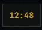
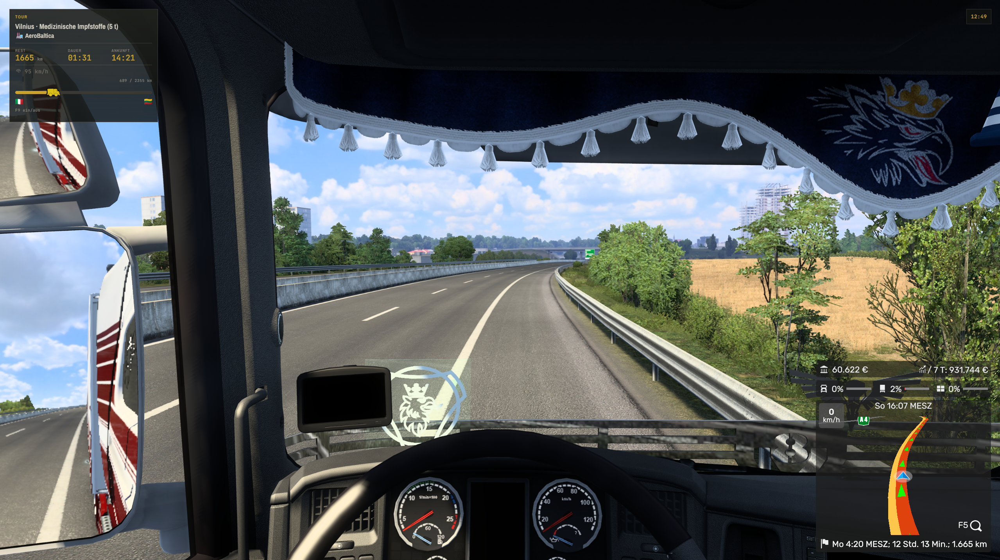

# Overlay ETS2

A small always-on-top tour HUD for Euro Truck Simulator 2 and TruckersMP.

It reads the same local FPH telemetry feed that SpedV uses (`127.0.0.1:25552`). No game mods. No cloud account.

<!-- After you add PNGs under docs/screenshots/, uncomment:



-->

## What you see

| Piece | Meaning |
| --- | --- |
| Tour line | Destination, cargo, weight in tonnes |
| Company | Delivery company with a factory marker |
| Flags | Start and destination country under the progress bar |
| Rest | Remaining km from the in-game navigation |
| Dauer | Real-world time left on your PC clock |
| Ankunft | Wall-clock arrival time |
| Tempomat | Cruise set speed (grey off, green on) |
| Progress | Driven / total navigation km with truck marker |
| Clock | Separate small real-time clock |

## How duration works

The game time scale is ignored.

```
duration = drive_rest_km / (game_km per real hour)
```

- Baseline is about 1000 game km per 60 real minutes.
- Short city or highway bursts do not rewrite the whole estimate.
- After enough distance and time on the job, a trip average blends in slowly (capped).
- While you stand still, duration stays put and arrival slides later.

If the first stable navigation reading is clearly longer than the job plan (ferry), that extra is locked once and subtracted from duration and arrival. The progress bar keeps the full navigation length. Later detours and wrong turns follow the live navigation number. They are not treated as a new ferry.

## Requirements

- Windows
- Node.js 18+
- FPH Telemetry (bundled with FPH SpedV) answering on `http://127.0.0.1:25552/api/ets2/telemetry`
- Euro Truck Simulator 2 (TruckersMP works the same way)

Any local server that returns the same JSON shape works if you set `ETS2_TELEMETRY_URL`.

## Install and run

```bash
git clone https://github.com/FlorianKarstenBartec/overlay-ets2.git
cd overlay-ets2
npm install
npm start
```

Or double-click `start.bat` after `npm install`.

## Controls

| Input | Action |
| --- | --- |
| F9 | Show or hide the tour HUD |
| Tray icon | Quit |

The tour HUD hides when the game is paused without a job, and when telemetry is disconnected. The clock stays available while the game is present.

## Config

| Environment variable | Default | Role |
| --- | --- | --- |
| `ETS2_TELEMETRY_URL` | `http://127.0.0.1:25552/api/ets2/telemetry` | Telemetry endpoint |
| `ETS2_POLL_MS` | `150` | Poll interval in ms |
| `ETS2_SEED_SPEED` | `95` | Seed speed for the throughput model |

## Project layout

```
main.js              Electron windows, tray, F9, IPC
preload.js           Bridge into the renderer
renderer/
  app.js             HUD state, progress bar, arrival banner
  telemetry.js       FPH JSON mapping
  eta.js             Real-time duration / arrival
  ferry.js           Ferry lock + rest used for ETA
  routeStore.js      localStorage for progress across restarts
  cities.js          City id / name to ISO country for flags
  index.html         Tour HUD
  clock.html         Small clock window
docs/screenshots/    README images
```

## Progress bar notes

- Totals come from navigation distance and are saved per job, so an overlay restart keeps `driven / total`.
- A longer route (waypoint or wrong turn) grows the total. Removing a waypoint without moving shrinks the total again so fake “driven” km do not stick.
- Rest in the HUD uses the same remaining km as the bar (`total - driven`).

## Screenshots

Add PNGs here:

| File | Content |
| --- | --- |
| `docs/screenshots/tour-hud.png` | Active tour HUD |
| `docs/screenshots/clock.png` | Clock window |
| `docs/screenshots/ingame.png` | Overlay on top of the game |

## License

MIT. See [LICENSE](LICENSE).
