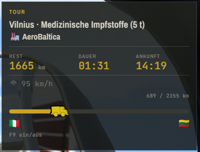

# Overlay ETS2

Kleines Always-on-top Overlay für Euro Truck Simulator 2 und TruckersMP.

Es liest denselben lokalen FPH-Telemetry-Feed wie SpedV unter `127.0.0.1:25552`.


Oben links sitzt die Tour-Anzeige. Unten rechts bleibt der normale ETS2-Route-Advisor. So hast du Ziel, Rest und Ankunft dauerhaft im Blick, ohne Menüs zu öffnen.

## Tour-HUD



| Bereich | Inhalt |
| --- | --- |
| Tour-Zeile | Zielstadt, Ladung, Gewicht in Tonnen |
| Firma | Empfängerfirma |
| Rest | Verbleibende km laut Ingame-Navigation |
| Dauer | Geschätzte Realzeit bis zum Ziel |
| Ankunft | Voraussichtliche Ankunftszeit |
| Tempomat | Gesetzte Geschwindigkeit, grau aus, grün an |
| Balken | Gefahren / Gesamt-Navi-km |
| Flaggen | Start- und Zielland unter dem Balken |

`F9` blendet das Tour-HUD ein und aus. Im Infobereich sitzt ein LKW-Tray-Icon. Links-Klick schaltet das Overlay, Rechts-Klick öffnet das Menü mit Beenden.

## Uhr


Kleine Realzeit-Uhr oben rechts. Sie bleibt sichtbar, solange das Spiel verbunden ist. Die Tour-Anzeige kann dagegen bei Pause ohne Auftrag ausblenden.

## Dauer und Ankunft

Die Ingame-Zeitskala fließt nicht in die Rechnung ein.

```
Dauer = Rest-km / (Spiel-km pro Realzeit-Stunde)
```

Ausgangswert sind etwa 1000 Spiel-km in 60 Realminuten. Kurze Stadt- oder Autobahn-Stücke reißen die Schätzung nicht um. Nach genug Strecke und Zeit auf dem Auftrag mischt sich ein Tour-Schnitt langsam ein.

Stehst du, bleibt die Dauer stehen. Die Ankunftszeit wandert nach hinten.

### Fähre

Ist die erste stabile Navi-Strecke klar länger als die geplante Job-km, wird die Differenz einmal als Fähre gelockt. Dauer und Ankunft rechnen ohne diesen Anteil. Der Fortschrittsbalken behält die volle Navi-Länge.

Spätere Umwege, falsch Abbiegen oder entfernte Wegpunkte folgen dem aktuellen Navi. Sie gelten nicht als neue Fähre.

### Balken

- Gesamt kommt aus der Navi-Strecke und wird pro Auftrag gespeichert. Ein Neustart des Overlays behält `gefahren / gesamt`.
- Wird die Route länger, wächst das Total. Nimmst du einen Marker wieder weg, ohne dich zu bewegen, schrumpft das Total zurück.
- Die Zahl unter **Rest** ist dieselbe Reststrecke wie am Balken (`gesamt − gefahren`).

## Voraussetzungen

- Windows
- Node.js 18 oder neuer
- FPH Telemetry (kommt mit FPH SpedV) und Antwort auf `http://127.0.0.1:25552/api/ets2/telemetry`
- Euro Truck Simulator 2 (TruckersMP funktioniert genauso)

Andere lokale Server mit demselben JSON-Format gehen über `ETS2_TELEMETRY_URL`.

## Installation und Start

```bash
git clone https://github.com/FlorianKarstenBartec/overlay-ets2.git
cd overlay-ets2
npm install
npm start
```

Nach `npm install` reicht auch ein Doppelklick auf `start.bat`.

## Bedienung

| Eingabe | Aktion |
| --- | --- |
| F9 | Tour-HUD ein oder aus |
| Tray links | Tour-HUD ein oder aus |
| Tray rechts | Menü, Beenden |

Das Tour-HUD blendet aus, wenn das Spiel pausiert ist und kein Auftrag läuft, und wenn keine Telemetry kommt. Die Uhr bleibt bei verbundenem Spiel.

## Konfiguration

| Umgebungsvariable | Standard | Bedeutung |
| --- | --- | --- |
| `ETS2_TELEMETRY_URL` | `http://127.0.0.1:25552/api/ets2/telemetry` | Telemetry-URL |
| `ETS2_POLL_MS` | `150` | Abfrageintervall in ms |
| `ETS2_SEED_SPEED` | `95` | Startwert für den Durchsatz |

## Projektstruktur

```
main.js              Fenster, Tray, F9, IPC
preload.js           Bridge in den Renderer
renderer/
  app.js             HUD-Zustand, Balken, Ankunftsbanner
  telemetry.js       Mapping vom FPH-JSON
  eta.js             Dauer und Ankunft in Realzeit
  ferry.js           Fähren-Lock und ETA-Rest
  routeStore.js      localStorage für Fortschritt über Neustarts
  cities.js          Stadt zu ISO-Land für Flaggen
  index.html         Tour-HUD
  clock.html         Uhr
docs/screenshots/    Bilder für diese README
```

## Lizenz

MIT. Siehe [LICENSE](LICENSE).
